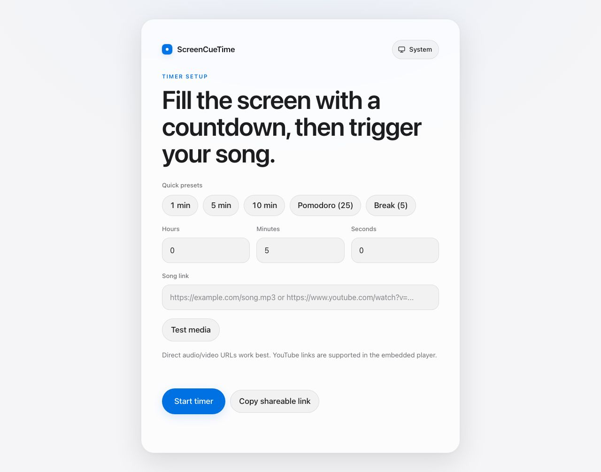
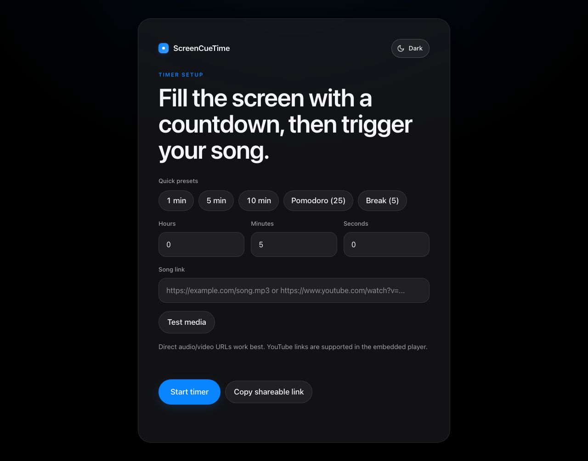
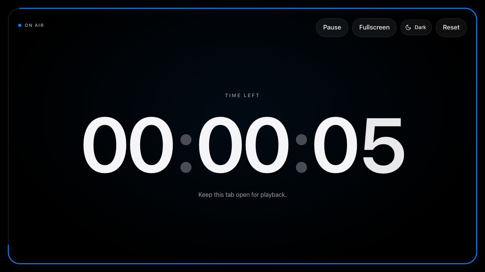
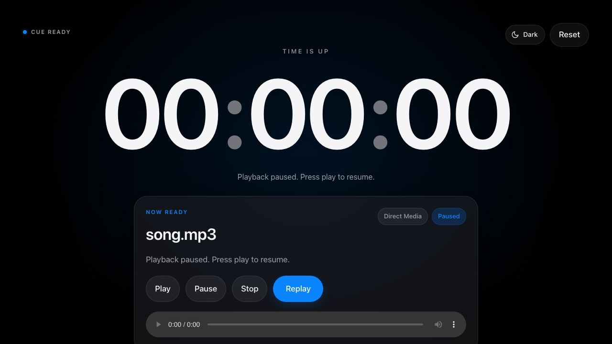
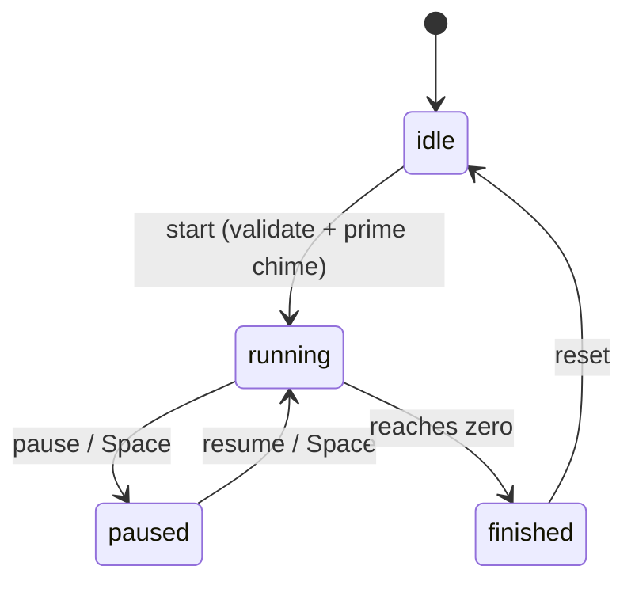

<div align="center">

# ScreenCueTime

### A fullscreen countdown that owns the room — then fires your cue.

A presenter-grade countdown timer for stage cues, event countdowns, watch parties, classrooms, and workout blocks. Set a duration, drop in a song link, and the screen becomes an immersive timer that triggers playback — plus a synthesized chime and a screen bloom — the instant it hits zero.

[](https://react.dev/)
[](https://vitejs.dev/)
[](#performance--dependency-budget)
[](#testing--quality-gates)
[](LICENSE)
[](#contributing)



</div>

---

## Table of contents

- [Why this project](#why-this-project)
- [What it looks like](#what-it-looks-like)
- [Features](#features)
- [Quick start](#quick-start)
- [How it works](#how-it-works)
- [Architecture](#architecture)
- [Testing & quality gates](#testing--quality-gates)
- [Accessibility](#accessibility)
- [Performance & dependency budget](#performance--dependency-budget)
- [Theming & design system](#theming--design-system)
- [Project structure](#project-structure)
- [Roadmap](#roadmap)
- [Tech stack](#tech-stack)
- [Contributing](#contributing)
- [License](#license)

---

## Why this project

ScreenCueTime is small on the surface — one screen, one job — and deliberately rigorous underneath. It is built to be read as much as used. If you are evaluating the engineering, here is what the codebase demonstrates:

- **An explicit finite-state machine** drives the timer (`idle → running ⇄ paused → finished`). State transitions are centralized and legible instead of scattered across booleans.
- **Orchestrator + pure-module architecture.** `App.jsx` coordinates state and side effects; every *decision* lives in a pure, independently testable module. Logic and the DOM are kept apart on purpose.
- **Testability designed in.** Storage access is injected (not reached through globals), so persistence is unit-tested against an in-memory stub. The build **fails** if any suite fails.
- **Progressive enhancement, not feature detection as an afterthought.** View Transitions, `requestFullscreen`, autoplay, and the Web Audio chime each degrade cleanly when unavailable, and every animation has a `prefers-reduced-motion` path.
- **Security-conscious input handling.** YouTube links are validated against an exact-hostname allowlist that deliberately rejects lookalikes (e.g. `evil-youtu.be.example.com`), with a regression test pinning the behavior.
- **A real performance and dependency budget.** The Phase 1 UI overhaul — theming, spring motion, animated numerals, a draining progress ring — added **zero** runtime dependencies. It is pure CSS, the View Transitions API, and a little JavaScript.

> The media-independent finish cue is the design thesis in one detail: the chime is *primed on the Start click* (to beat autoplay policy) and always fires at zero, so the finish lands even if the media fails to load.

## What it looks like

| Setup — light | Setup — dark |
| :---: | :---: |
|  |  |

| Running — the presenter stage | Finished — the cue fires |
| :---: | :---: |
|  |  |

## Features

- 🎬 **Fullscreen presenter mode** — true `requestFullscreen()` with a perimeter progress ring that drains as time runs down, and controls that auto-hide when idle.
- 🔢 **Tabular animated numerals** — fixed-width figures that never jitter, with a per-digit spring roll on every change.
- 🔔 **A finish that always lands** — a Web Audio chime primed on Start, plus a screen bloom, independent of whether the media plays.
- 🎵 **Direct audio/video URLs and YouTube** — classified, validated, and embedded in a visible player with play/pause/stop/replay.
- 🌗 **Light / dark / system theming** — a design-token system with a persisted toggle and a no-flash bootstrap.
- ⏯️ **Pause / resume**, keyboard control (`Space`), and a reset that returns to setup.
- ⚡ **Quick presets & recent timers** — one-tap durations; the last few timers are remembered in `localStorage`.
- 🔗 **Shareable links** — the full setup encodes into the URL for bookmarking or sending.
- ♿ **Accessible & responsive** — focus management, polite screen-reader announcements, full reduced-motion support, and a layout that holds from phone to desktop.

## Quick start

> **Requirements:** Node 16+ **or** [Bun](https://bun.sh/) 1.3+. Commands below work with either (`bun` shown; swap `bun` for `npm run` if you use Node).

```bash
# install
bun install            # or: npm install

# develop (Vite dev server, usually http://localhost:5173)
bun run dev            # or: npm run dev

# run the unit suite
bun run test           # or: npm run test

# production build (runs the tests first, then builds to dist/)
bun run build          # or: npm run build
```

| Command | What it does |
| --- | --- |
| `dev` | Starts the Vite dev server with HMR |
| `test` | Runs all unit suites via the custom runner |
| `build` | **Runs the tests, then** builds to `dist/` — a red test fails the build |
| `preview` | Serves the production build for verification |

## How it works

1. Enter a duration (or tap a preset) and a song link. A shared link can prefill the whole setup from the URL.
2. Optionally **test the media** so a broken link is caught before the timer starts.
3. On start, the link is classified as a **direct media URL** or an **embeddable YouTube** video, a target timestamp is computed, and the chime is primed under the user's click gesture.
4. The stage takes over fullscreen; the countdown ticks and the perimeter ring drains. Pause/resume as needed.
5. At zero: the chime fires and the screen blooms (always), direct audio plays through a visible panel, or YouTube launches in an embedded player. If autoplay is blocked, manual controls stay visible.

## Architecture

Single-page React 18 + Vite front end, no backend. The guiding rule: **`App.jsx` orchestrates; pure modules decide.**



| Module | Responsibility | Tested |
| --- | --- | :---: |
| `src/App.jsx` | The only stateful layer: the `TIMER_PHASE` machine, countdown lifecycle, playback orchestration, theming, fullscreen, keyboard & focus. | — |
| `src/timerUtils.js` | Media classification, time formatting, and the YouTube host-allowlist validation. | ✅ |
| `src/playback.js` | `PLAYBACK_STATUS` model and user-facing playback messaging. | ✅ |
| `src/presets.js` | Quick-start presets + the `localStorage`-backed recent-timer history (storage injected). | ✅ |
| `src/shareLink.js` | Encode/decode a timer config to/from URL query parameters. | ✅ |
| `src/theme.js` | Light/dark/system resolution and persistence (storage injected). | ✅ |
| `src/cue.js` | Media-independent finish chime built on the Web Audio API. | — |
| `src/viewTransition.js` | View Transitions wrapper with reduced-motion and no-support fallbacks. | — |
| `src/CountdownDisplay.jsx` · `ProgressRing.jsx` · `ThemeToggle.jsx` · `PlaybackPanel.jsx` | Presentational components driven by props. | — |

Pure modules (`timerUtils`, `playback`, `presets`, `shareLink`, `theme`) carry the logic and the tests. `App.jsx`, `cue.js`, and the components are DOM/browser-bound and verified by build + manual/visual QA.

## Testing & quality gates

- **Zero-dependency test runner.** Each `*.test.js` default-exports a function that asserts with Node's built-in `node:assert` and throws on failure; `scripts/run-tests.mjs` runs them. No Jest, no Vitest, no config.
- **The build is the gate.** `npm run build` runs the suite first and refuses to build on a failure.
- **Run one suite in isolation:**
  ```bash
  node --input-type=module -e 'import run from "./src/theme.test.js"; run();'
  ```
- Adding a suite is two steps: create `src/<name>.test.js` exporting a zero-arg function, then register it in the `testSuites` array in `scripts/run-tests.mjs`.

## Accessibility

- Focus moves to the countdown stage when it takes over the screen.
- A polite `aria-live` region announces remaining time at meaningful milestones (every 15s and the final 10s) — never on every 250 ms tick.
- `Space` toggles pause/resume; the big numerals are `aria-hidden` so the live region is the single source of spoken truth.
- Every animation — digit rolls, the finish bloom, phase transitions — has a `prefers-reduced-motion` path, enforced by a global reduced-motion rule.
- Color tokens target WCAG-contrast surfaces in both themes.

## Performance & dependency budget

- **Runtime dependencies: `react` + `react-dom`, and nothing else.** The Phase 1 UI overhaul added none.
- Motion is the View Transitions API + CSS springs. No animation library.
- Production bundle (gzipped): **~53 KB JS**, **~3.5 KB CSS**.
- Countdown ticks ~4×/second against a target timestamp (not accumulated intervals), so it stays accurate across tab throttling.

## Theming & design system

Color, spacing, radii, and motion easing are CSS custom properties on `:root`, redefined for dark under both `prefers-color-scheme` and an explicit `[data-theme]` attribute. A tiny inline bootstrap applies the saved/system theme before first paint, so there is no flash. The toggle cycles **System → Light → Dark** and persists the choice. Typography uses the system font stack (SF on Apple devices) with Inter as the cross-platform fallback and tabular figures for the countdown.

## Project structure

```text
.
├── index.html                 # entry + no-flash theme bootstrap
├── scripts/run-tests.mjs      # the custom test runner
├── docs/
│   ├── assets/                # README demo (animated SVG) + screenshots
│   ├── product-spec.md
│   └── implementation-plan.md
└── src/
    ├── App.jsx                # orchestrator + state machine
    ├── CountdownDisplay.jsx   # animated tabular numerals
    ├── ProgressRing.jsx       # draining perimeter ring
    ├── ThemeToggle.jsx        # system/light/dark control
    ├── PlaybackPanel.jsx      # finished-state media panel
    ├── cue.js                 # Web Audio finish chime
    ├── theme.js (+ test)      # theming model
    ├── timerUtils.js (+ test) # media classification, time format
    ├── playback.js (+ test)   # playback status model
    ├── presets.js (+ test)    # presets + recents
    ├── shareLink.js (+ test)  # URL encode/decode
    ├── viewTransition.js      # View Transitions wrapper
    └── styles.css             # tokenized design system
```

## Roadmap

- [x] **Phase 1 — Flagship UI**: theming, animated tabular numerals, perimeter ring, View-Transition phase morphs, fullscreen presenter mode, finish bloom, accessibility & responsive pass.
- [ ] **Phase 2 — Depth**: YouTube title/thumbnail via oEmbed, multi-cue sequences (work → break chains), named/savable timers, a keyboard-shortcut overlay and settings surface.
- [ ] **Phase 3 — Reach**: a landing/hero with a live demo, polished "someone sent you a cue" share pages, PWA/offline support, and the official YouTube IFrame Player API.

## Tech stack

| Tool | Purpose |
| --- | --- |
| **React 18** | UI and state |
| **Vite 4** | Dev server and build |
| **Plain CSS** | Tokenized design system, theming, motion |
| **Web APIs** | Web Audio (chime), View Transitions, Fullscreen, `localStorage` |

## Contributing

Issues and PRs are welcome.

1. Fork and branch from `main`.
2. Keep logic in pure modules and add a matching `*.test.js` (register it in `scripts/run-tests.mjs`).
3. Make sure `bun run build` (which runs the tests) is green before opening a PR.

## License

Released under the [MIT License](LICENSE).

<div align="center"><sub>Designed and built with care — and with <a href="https://claude.com/claude-code">Claude Code</a>.</sub></div>
